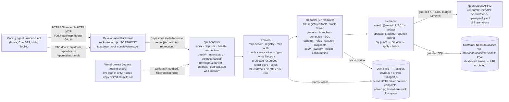

# Relational map — Neon Unleashed (neon-mcp)

How the whole system connects, in plain diagrams. This is the readable
system map required by the fleet rule adopted 2026-11-18 (see
`docs/RULES.md`). It describes the system **as built** — for dated
implementation history see `docs/ARCHITECTURE.md`, for current status
`docs/STATUS.md`, for the tool list `docs/TOOL-CATALOG.md`.

Last refreshed: 2026-11-18, from `main` (139 registered tools).

## The system in one picture

## Wires, named

- **Client → server:** agents connect directly (no Hub required) to
  `POST /api/mcp` — stateless Streamable HTTP, OAuth 2.1 bearer.
  Discovery lives at `/.well-known/oauth-authorization-server` and
  `/.well-known/oauth-protected-resource`; registration, authorize,
  token and revoke live under `/api/oauth/*`.
- **RTC / Hub door:** `api/rtc.js` serves `/api/tools`,
  `/api/tools/:name`, `/api/whoami` and `/api/results/:handle`
  (rewrites in `vercel.json`, reproduced in `rack-server.mjs`), so
  Robinson's Toolkit (the Hub) can offer this server alongside the
  others without holding provider schemas in the agent's menu.
- **Two runtimes, one code path:** on the rack, `rack-server.mjs`
  dispatches to the exact `api/` handlers Vercel would invoke; in
  source there is no separate rack adaptation layer. Fleet pattern:
  `main` = development, `live` = production (daily-live promotion);
  production currently serves from the rack, and the hosted Vercel
  copy was retired 2026-11-08.
- **MCP dispatch:** `src/core/mcp-server.js` + `src/core/registry.js`
  merge tool namespaces from `src/tools/index.js`; duplicate names or
  missing handlers throw at startup. Tools are profile-filtered
  (read / developer / owner) by the caller's OAuth connection.
- **Every write is guarded:** `src/core/write.js` reserves a durable
  audit row in `change_log` before any external mutation, previews
  before changes, classifies production / protected resources
  (`src/neon/production.js`, `src/core/protected-resources.js`), and
  admits spend (`src/neon/spend.js`, `src/neon/pricing.js`) before a
  mutation is sent. Missing guards deny execution.
- **SQL path:** classify (`src/neon/sql-guard.js`, parsed with
  libpg-query) → read in a `BEGIN READ ONLY` bounded transaction, or
  preview on a disposable child branch → one-use hash-bound token →
  apply with affected-count comparison and rollback on mismatch.
- **Neon API path:** only `src/neon/client.js` imports `@neon/sdk`.
  Every request is budget-admitted against the atomic `rate_limits`
  ledger in the own store; long operations poll with a bounded budget
  (`src/neon/operations.js`) and unknown write outcomes stay pending —
  never replayed blindly.
- **Own store:** `src/db.js` is read lazily (`DATABASE_URL` never at
  import). `src/db-transport.js` is the one transport seam: Neon HTTP
  driver when the URL names a `*.neon.tech` endpoint, pooled `pg`
  otherwise. Tables include `neon_orgs`, `neon_keys` (AES-256-GCM
  ciphertext only, `src/core/crypto.js`), `oauth_clients / codes /
  tokens`, `login_attempts`, `rate_limits`, `change_log`,
  `one_time_secrets`, `secret_requests`, `settings`, `result_store`.
- **Results:** large tool results are scrubbed (`src/core/scrub.js`),
  stored behind random `res_…` handles in `result_store` (24 h), and
  paged back through `neon_get_result` / the RTC results door.
- **Health:** `/api/health` and `src/service-health.js` report
  degraded until an explicitly enabled independent database probe
  succeeds — configuration presence alone is not a pass.

## Areas

| File | Area |
|---|---|
| [runtime-and-routes.md](runtime-and-routes.md) | Entry points, HTTP routes, OAuth, RTC doors, public pages |
| [tools-and-guards.md](tools-and-guards.md) | Tool families, write lifecycle, SQL guard chain, spend/budget |
| [data-and-external.md](data-and-external.md) | Own store, Neon API, target databases, CI and release trains |

## External services

- **Neon Cloud** — the provider this server operates (API + SQL).
- **Postgres (rack)** — this server's own store in production.
- **GitHub** — source, CI (`.github/workflows/ci.yml`: check / unit /
  db jobs, aggregate `ci` gate), daily-live promotion workflow.
- **Robinson's Toolkit / Hub** — optional consumer via the RTC door;
  the server works fully standalone.
