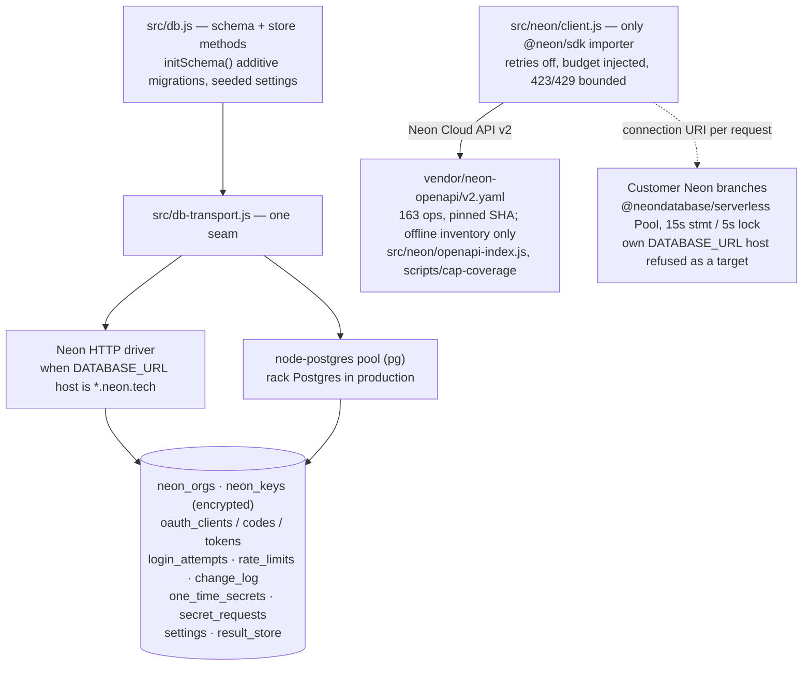

# Data and external connections — neon-mcp

- **Secrets:** `TOKEN_ENCRYPTION_KEY` (AES-256-GCM, scope-bound) and
  `ADMIN_PASSPHRASE` come from the environment; values never appear
  in docs, logs or tool results (`src/core/scrub.js`).
- **CI:** `.github/workflows/ci.yml` — `check` (secret scan, docs,
  lint, write-safety, budgets), `unit` (fake Neon,
  `test/helpers/fake-neon.js`), `db` (throwaway Postgres 17);
  aggregate `ci` job is the single merge gate. CI never calls Neon.
- **Release:** `daily-live.yml` promotes `main` → `live` on the
  nightly train (owner releases are uncapped per the 2026-11-04
  rule); `git-housekeeping.yml` and `prune-merged-branches.yml`
  keep branches tidy. Production runtime is the rack (see README).
- **Checks on docs:** `npm run check` includes
  `scripts/check-docs-updated.mjs` and
  `scripts/check-doc-code-truth.mjs` — this map is refreshed in the
  same change as any feature, per `docs/RULES.md`.
