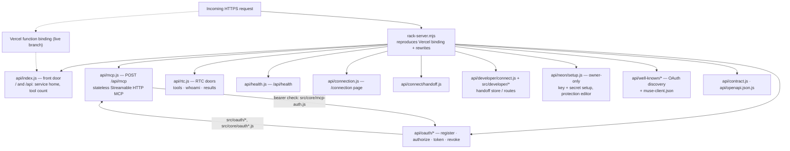

# Runtime and routes — neon-mcp

Node-and-wire list:

- `rack-server.mjs` — depends-on: every `api/**` handler; reads
  `PORT`/`HOST`; reproduces `vercel.json` rewrites verbatim
  (`/connection`, both `/.well-known/oauth-*`, RTC doors).
  `rack-init-store.mjs` prepares the rack own-store.
- `api/mcp.js` — calls: `src/core/mcp-server.js` dispatch;
  authenticates via `src/core/mcp-auth.js` against OAuth tokens in
  the own store.
- `api/oauth/*` — calls: `src/oauth/routes.js`,
  `src/oauth/register-route.js`, `src/core/oauth.js` (SHA-256
  hashing, S256 PKCE, lockout), `src/core/oauth-revocation.js`
  (revoke touches only the calling client's own token row).
- `api/neon/setup.js` — owner-only (passphrase + origin + lockout);
  reads/writes `settings.protected_resources`, key enrollment via
  `src/neon/keys.js`; never enables production by itself.
- `src/developer/handoff*.js` — developer handoff surface behind
  `api/developer/connect.js` and `api/connect/handoff.js`.
- Public surfaces: front door, `/connection`, health, OAuth
  discovery documents, `/.well-known/muse-client.json`.
