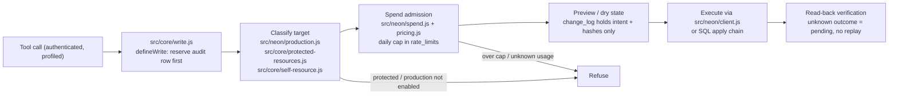

# Tools and guards — neon-mcp

Tool families in `src/tools/` (registered in `src/tools/index.js`,
139 tools total, profile-filtered):

- **Accounts & owners** — `projects`, `project-writes`,
  `project-settings-writes`, `project-context`, `owner-reads`,
  `owner-writes` (keys), `owner-administration`, `owner-transfers`,
  `owner-registrations`, `owner-production`, `organization-access*`.
- **Data plane shape** — `branches`, `branch-writes`,
  `branch-lifecycle`, `branch-restores`, `computes`,
  `compute-lifecycle`, `compute-spend`, `connections`, `consumption`,
  `operations`, `snapshots` + `snapshot-*`, `migration-history`.
- **Schema & data** — `schema-discovery`, `schema-reads`,
  `schema-types`, `schema-ddl`, `schema-index-write`,
  `schema-extension-*`, `data-compare`, `index-advice`.
- **Roles & security** — `role-*`, `database-role-reads`,
  `security`, `security-writes`, `security-ip-allow`,
  `security-jwks-writes`, `security-audit-writes`, `key-access`.
- **SQL** — `sql`, `sql-preview`, `sql-execute`, `sql-stop`.
- **Developer loop** — `dev-*` (scenarios, seed, checkpoints,
  migration preview, anonymized copies, integration, tune, runs),
  backed by pure planners in `src/dev/`.
- **Health & meta** — `health-check`, `health-vacuum`,
  `health-reindex`, `meta`, `server`, `server-settings`.

SQL chain: `sql-guard.js` (parse + classify one statement) →
`sql-read.js` (read-only txn) or `sql-preview.js` (disposable child
branch, 30-minute hash-bound token in `change_log`) →
`sql-admission.js` (spend guard) → `sql-apply.js` (reserve request
key, consume token, compare affected counts, rollback on mismatch).
`sql-estimate.js` is the bounded EXPLAIN-only fallback.
